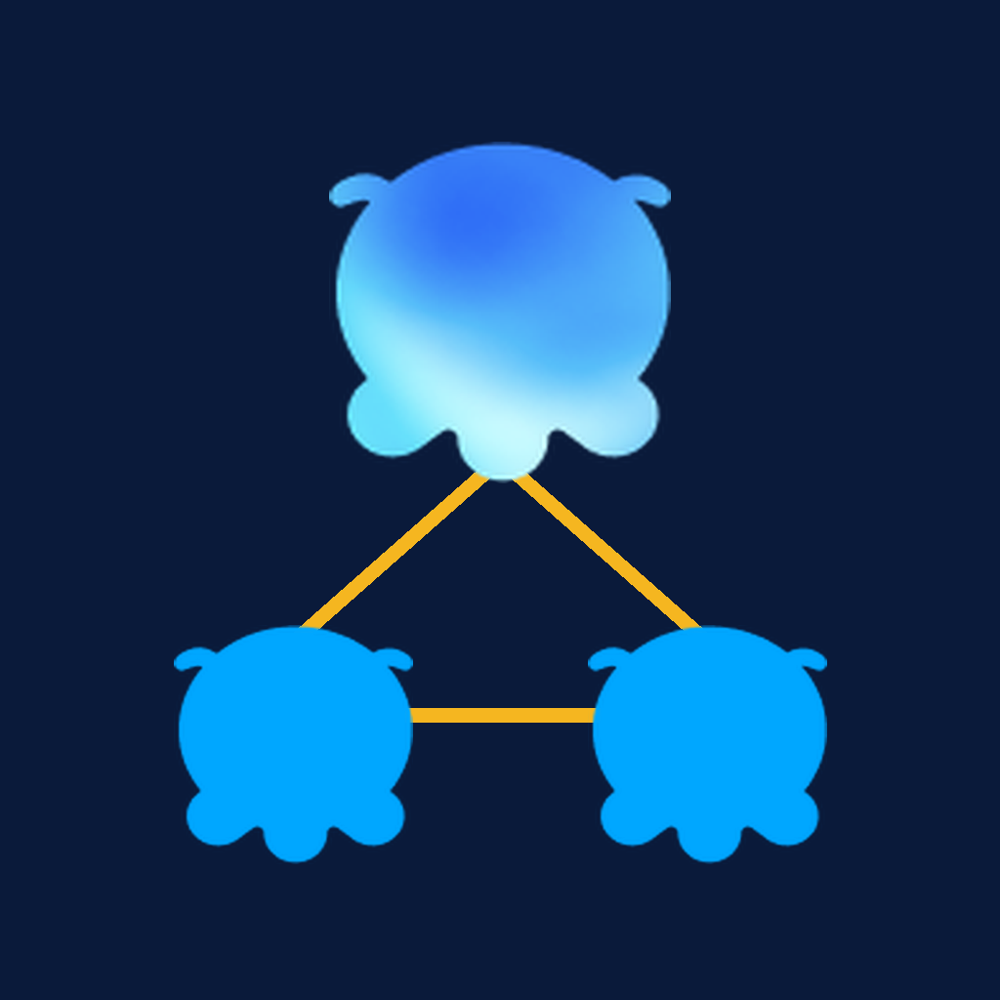
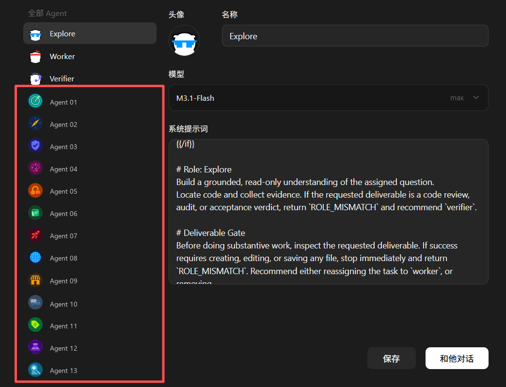

<p align="center">
  
</p>

<h1 align="center">minimax-code-team-builder</h1>

[](https://github.com/DF-Guan/minimax-code-team-builder/actions/workflows/ci.yml)


<p align="center">
  <a href="README.md">English</a> · <a href="README.zh-CN.md">简体中文</a>
</p>

<p align="center">
  在 <b>MiniMax Code</b> 和 <b>MiniMax Inside Code</b> 内测版里，用一句话批量组建一支能互相协作的
  <b>Subagent 团队</b>。
</p>

---

## 就这么用

### 1 · 在 MiniMax Code 里 —— 直接说人话

不用敲命令、不用建文件、不用懂术语，想到什么就说什么：

```
建个三人小组：一个查资料，一个分析，一个写结论
```

```
发个 ai agent 对话，角色是 审校 / 翻译 / 发布
```

```
帮我搭一支做数据分析的团队
```

```
我想要三个 agent：一个查、一个写、一个查错
```

Skill 最多问你一轮简短问题，然后把整套东西一次做完：每个角色的 `agent.md` 按运行时的确切契约写好、
每个 Agent 原生注册（**插件·技能 → 管理 → Agents** 里直接能看到）、每个角色配一张专属生成头像、
跑一遍校验、装上编排器读得到的团队名册、再做一次预热，让同伴之间真的接得上活。

### 2 · 在终端里 —— 一条命令

```bash
npx github:DF-Guan/minimax-code-team-builder --init          # 生成一个起步用的 team.json
npx github:DF-Guan/minimax-code-team-builder --blueprint team.json
```

终端这条路负责**可复现的那一半**：蓝图 → `agent.md` 文件 → 校验。
另一半（注册、头像、名册、预热）是 Skill 在对话里做的。
蓝图需要进版本库、或者构建要跑在 CI 上时，用终端这条路。

### 3 · 当成 Skill 装 —— 拷目录即可

Skill 就是一个普通目录。把它拷到 MCode 的用户 Skill 根目录（运行时数据目录里，也就是放着
`agents/` 的那个文件夹）：

| 平台 | Skill 根目录 |
| --- | --- |
| Windows | `<dataDir>\skills\` |
| macOS / Linux | `~/.minimax/skills/` |

```powershell
git clone https://github.com/DF-Guan/minimax-code-team-builder.git
Copy-Item -Recurse -Force .\minimax-code-team-builder\minimax-code-team-builder "<dataDir>\skills\minimax-code-team-builder"
```

数据目录是可搬的，别写死路径 —— `MINIMAX_DATA_DIR` / `MAVIS_DATA_DIR` 指向它，App 设置里也能看到。
拷完**重启 MCode**。

---

## 你会得到什么

| | |
| --- | --- |
| **一支真团队** | 每个角色一份 `agent.md`，按运行时的确切契约写好 —— 不是还要你再改一遍的草稿 |
| **已注册** | 每个 Agent 都会出现在 **插件·技能 → 管理 → Agents**，可以按名字被调度 |
| **认得出** | 每个角色一张专属生成头像，名册一眼能扫，不用对着一排字母头像猜 |
| **已校验** | 按运行时自己的解析器复核，green 就代表运行时会收下每个文件 |
| **已接线** | 装上编排器读得到的私有名册 —— 运行时不会往任何 prompt 里注入 Agent 名单 |
| **能协作** | 预热 + 统一交接块，成员之间真的能互相把活传下去 |

你永远不用碰一个 frontmatter 键、不用猜模型 id、不用去读运行时源码。
这正是这个 Skill 的价值：运行时的坑已经被钉死在这儿了，剩下的判断只有「角色怎么分」。

## 效果展示



*MiniMax Code 的「全部 Agent」面板。红框里是一支 16 人团队，一次创建出来的。
图中的 Agent 名称已做脱敏，头像是真实产出。*

---

## 团队落在哪

团队在**发起请求的那台机器**的环境里构建，然后就是那台机器上产品的一部分：

- 出现在 **插件·技能 → 管理 → Agents**，和内建 Agent 并排，跟从 UI 建出来的没区别；
- 运行中的编排器会像认任何 Agent 一样认它，并按名字派活给它。

**它不会自己跑到别的桌面端。** 每个客户端各有一份自己的 Agent 集合（`<dataDir>/agents/`），
本机 agent 服务从不跟账号通信，所以一台机器上建的团队在另一台上不存在。
**可移植的产物是蓝图**：把 `team.json` 拷过去再跑一遍构建器，或者直接把 agent 目录拷过去。

**Web / 账号名册是另一份独立存储** —— 账号级 Agent 列表和头像都存在那一侧。
把生成的头像推进去（`scripts/push_cloud_avatars.py`）改的是账号侧那份头像，
**依然不会**把 Agent 本身装到别的桌面端。

## 为什么不直接让模型写 `agent.md`？

因为没研究过运行时的模型会踩这些坑，而且**每一步都是静默失败**：

| 会出什么错 | 为什么没声音 | 这个仓库钉死了什么 |
| --- | --- | --- |
| 正文里留下字面量 `{{#if persona.enabled}}` | 自定义 Agent 的解析器不渲染模板 —— 那段原样进 prompt | 自定义 Agent 的正文**逐字**使用，没有 persona 拆分 |
| 面板里 Agent 没有名字 | 自定义 Agent 的索引行**不存任何身份** —— 名字/描述/头像只在 `agent.md` 里 | 到底有哪些 frontmatter 键，身份真正存在哪 |
| `skills: []` | 空数组是**拒绝全部**的白名单，不是「不限制」 | `tools` / `skills` 的选择器语义 |
| 团队永远不调度 | 自定义 Agent 不能 spawn 子 Agent，而没跑过的同伴没有会话 | 单向 spawn 规则、预热步骤、交接契约 |
| 模型 id 被拒 | `model` 必须是 `provider/model`，光写名字不行 | 带 provider 前缀的 id，以及 effort / 上下文选项 |
| 头像裂图 | 生成器可能把 `.png` 返成 JPEG，而运行时按字节嗅探扩展名 | 按真实格式命名文件 |

上面每一行都是在**跑着的客户端**上验证过的规则，不是照着文档猜的。

## 里面有什么

```
minimax-code-team-builder/
├── minimax-code-team-builder/          # 可安装的 Mavis Skill
│   ├── SKILL.md                 # 流程：采集 → 蓝图 → 构建 → 接线 → 校验
│   ├── icon.png                 # Skill 徽标
│   ├── references/
│   │   ├── agent-md-spec.md     # agent.md 的运行时契约
│   │   ├── blueprint-schema.md  # 蓝图格式与团队设计规则
│   │   └── collaboration.md     # spawn / 交接模型、预热、交接块
│   └── scripts/
│       ├── scaffold_team.py     # 蓝图 → agent.md（幂等）
│       ├── validate_team.py     # 按运行时规则复核
│       ├── avatar_batch.py      # 蓝图 → 图像生成请求
│       ├── build_roster_skill.py# 蓝图 → 编排器私有名册
│       └── push_cloud_avatars.py # 本地头像 → 账号 / Web 名册
├── bin/mcode-team-builder.js   # npx 入口
├── examples/                    # 开箱即用的蓝图（fast path 用）
│   ├── team.example.json        # 三角色发布文档团队
│   ├── team.research.json       # 三角色研究团队
│   └── team.content.json        # 三角色内容团队
├── tests/sandbox_test.py        # 脚本测试：dry-run、幂等、负例
├── package.json
├── README.md
├── README.zh-CN.md
└── LICENSE
```

## 直接用脚本

脚本是零依赖的单文件，适合 CI 或别的工具驱动，也适合把蓝图放进版本库。

```bash
# 1. 先看计划
python minimax-code-team-builder/scripts/scaffold_team.py --blueprint examples/team.example.json --dry-run

# 2. 写入
python minimax-code-team-builder/scripts/scaffold_team.py --blueprint examples/team.example.json --data-dir <dataDir>

# 3. 复核
python minimax-code-team-builder/scripts/validate_team.py --blueprint examples/team.example.json --data-dir <dataDir>
```

`--data-dir` 是 MCode 数据目录 —— 装着 `agents/` 的那个文件夹。
脚本也认 `MINIMAX_DATA_DIR` / `MAVIS_DATA_DIR` / `__MAVIS_RUNTIME_DATA_DIR`，所以从不写死任何机器路径。

## 协作模型一张图

```
用户 ──▶ 根 Agent (mavis)
            │  task(agent_name="agent:<slug>")   ← 唯一的 spawn 路径
            ▼
         负责人 / 编排者  ── mavis session send(同伴会话 id, sync=true) ──▶ 专员
            ▲                                                                        │
            └────────────────── 回执，session send 回去 ───────────────────────────┘
```

| 从谁发起 | 能 `task` 拉起子 Agent | 能用 `session send` 找同伴 |
| --- | --- | --- |
| 根交互会话 | 可以 | 可以 |
| 自定义 Agent | 不行 | 可以，但对方得先有会话 |

完整规则、预热步骤和交接块见
`minimax-code-team-builder/references/collaboration.md`。

## 真正要紧的设计规则

1. **一项能力一个主人。** 两个 Agent 都声称能做同一件事，路由就会随机。
2. **`description` 就是全部路由信号。** 每个都要写得能互相区分开。
3. **会话只在 Agent 跑过一次之后才存在。** 第一个真实任务之前先预热。
4. **名册要跟团队一起交付。** 运行时不会往编排器 prompt 里注入 Agent 名单 —— 名册得装成私有 Agent Skill。
5. **新团队的角色控制在八个左右。** 再多，路由就不稳了，而且大部分时间都耗在交接上。

## 质量

- 通过 Mavis Skill linter（`lint-skill.js`）：frontmatter 合法、名字 kebab-case、无禁用文件、
  `references/` 链接全部可解析、正文未超行数上限。
- 脚本每次改动都在临时数据目录上跑过；脚手架是幂等的，且会保留已有头像。
- Skill 与「无 Skill 基线」在同一道构建请求上做过对照评测：基线组得自己从 app bundle 里把运行时
  的解析器抽出来、自己手写 registry 行才能注册；用 Skill 的话，解析规则、registry 结构、名册和
  头像都直接来自这个仓库。
- **整套流程在真实 runtime 里端到端跑过**：脚手架 → 原生注册 → 生成头像 → 校验 → 名册 → 预热 →
  一次真实的同伴交接（`session send` + `sync: true`，拿到回执）。过程中暴露两个 bug，均已修：
  名册 Skill 的 frontmatter 名字与目录不一致导致**按名加载不了**；以及让 Agent 自报模型 / 上下文窗口 /
  effort 时它会**靠猜**回答 —— 权威来源是 runtime 冻结的 Agent 定义，不是对话记录。
- 全新 `git clone` 回来能过 linter 和脚本测试 —— 也就是说验的是**发布后的克隆**，不只是工作副本。

## 需要什么

- MiniMax Code 桌面端或 `mcode` CLI，带本机 runtime。
- Python 3.9+（脚本用，无第三方依赖）；Node 18+（`npx` 入口用）。
- 原生 `mavis` 工具负责注册与调度 —— 它是 App 自带的 runtime 工具，不是 shell 命令。
- 登录账号 —— 只有想同时把生成的头像推到 Web / 账号名册时才需要
  （`scripts/push_cloud_avatars.py`）。

## 许可

MIT —— 见 [LICENSE](LICENSE)。
